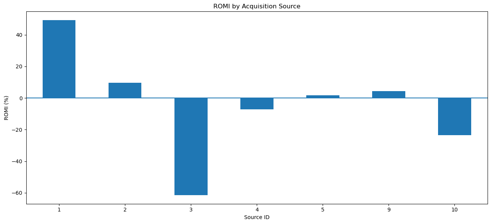

# Marketing Performance & Cohort Analysis

A Y.Afisha case study connecting product activity, purchasing behavior, cohort revenue, and acquisition spending.

## Business question

Which acquisition sources warrant further investment or investigation when user volume, buying behavior, acquisition cost, and observed revenue are considered together?

## Key findings

- **359,400 sessions and 50,415 orders** provide the basis for the analysis.
- **72.18% of observed buyers purchased within 24 hours** of their first recorded visit; **82.77% placed only one order** within the observation window.
- **Source 3 received the largest spend: 141,321.63**, but its observed revenue-based return was **−61.43%**.
- **Source 1 had the highest observed revenue-based return: +49.24%**. Its cost per acquired user was **2.20**, while its cost per paying customer was **7.19**.
- Low user-acquisition cost does not necessarily correspond to strong revenue recovery: source 10 cost approximately **0.84 per user** but had **−23.57%** observed revenue-based return.



**Recommendation:** Investigate source 3's targeting and unit economics, and evaluate source 1 with a controlled incremental budget test. Compare cohorts at the same age and include contribution margins before reallocating or scaling spend.

## Analytical approach

1. Inspect data quality and timestamps; retain sessions with invalid durations for activity counts but exclude those durations from averages.
2. Calculate active users, sessions, duration distributions, and acquisition-cohort retention.
3. Analyze time to first purchase, repeat orders, order value, and observed cumulative revenue per buyer cohort.
4. Attribute users and orders consistently to one first-observed source.
5. Distinguish acquisition cost per user from acquisition cost per paying customer and compare source revenue with spend.

[Read the executed notebook](analysis.ipynb) · [Explore the retention heatmap](cohort_retention.png)

**Tools:** Python, Pandas, Matplotlib, Seaborn, Jupyter.

## Metric definitions

| Metric | Definition |
|---|---|
| Cost per acquired user | Source spend / unique users first observed through the source |
| Paying-customer CAC | Source spend / unique buyers attributed to the source |
| Observed cohort LTV | Cumulative observed revenue / initial buyers in the cohort |
| Revenue-based ROMI proxy | (Attributed revenue − marketing spend) / marketing spend |

The ROMI proxy excludes margins and other operating costs. It is not profit ROI, and attribution does not establish incremental causality. “LTV” is observed revenue, not a lifetime-profit forecast.

## Interpretation limits

- First-observed touch is a convention: activity before the dataset begins and later touchpoints are not credited. One timestamp tie is resolved by input row order.
- Source costs and revenues are pooled over the observation window. They are not matched acquisition-cohort CAC or age-standardized channel returns.
- Visits and spend cover June 2017–May 2018; supplied orders extend briefly into June 1. Source totals retain those orders. Incomplete June revenue is excluded from cohort LTV comparisons.
- Most recent cohorts have less follow-up time. Device audiences overlap and are not mutually exclusive.
- Missing cost data for sources 6 and 7 prevent a comparable return calculation; missing costs are not assumed to be zero.
- Channel rankings describe this historical educational dataset and do not predict returns from additional spending.

## Reproduce

Install dependencies in an isolated Python environment:

```bash
pip install -r requirements.txt
jupyter lab
```

Place the three CSVs in `data/` following [DATA.md](DATA.md). Open `analysis.ipynb` from the repository directory and run all cells.

## Provenance and validation

Analysis by Gabriella Ferraz Gomes, developed during the TripleTen Data Analytics bootcamp. The portfolio edition preserves the analytical structure and adds consistent attribution, validated joins, explicit metric definitions, and data-quality handling.

All 85 code cells executed in order in a fresh Python 3.13 IPython process with no cell errors or warnings. Checks confirmed that each acquired user is attributed once and every order is preserved in the source join. Figures and outputs were regenerated using the supplied files. Package versions are recorded in `requirements.txt`.
